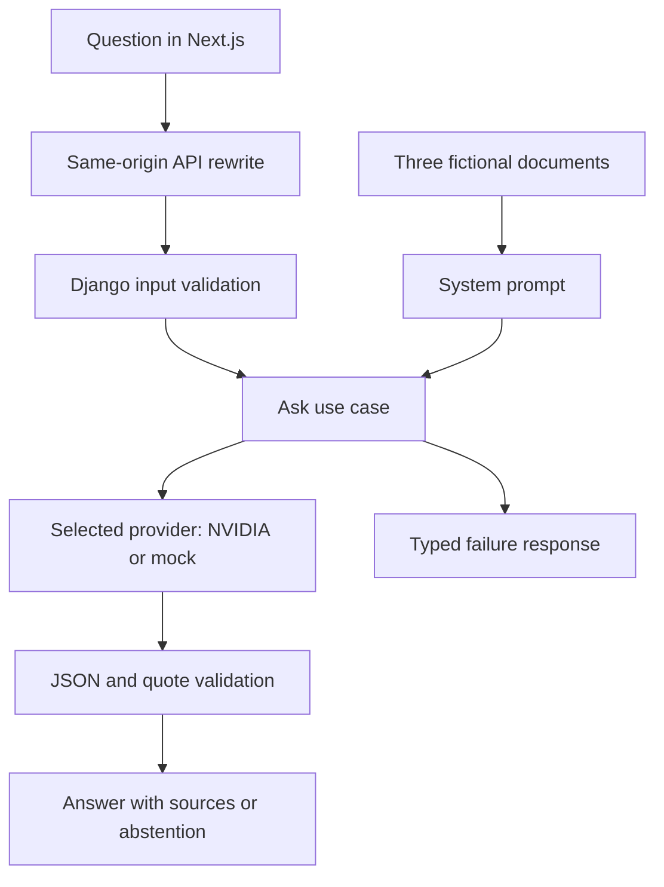

# 🌿 BrightPath Learn · Help Desk

**Ask a question. Read an answer. Check the source.**

[🌐 Live demo](https://brightpath-learn-helpdesk.vercel.app) · [💻 Source code](https://github.com/JaredBautist/brightpath-learn-helpdesk) · [🧪 Hosted results](HOSTED_TEST_RESULTS.md)

A small document-grounded help center built with **Next.js, React, TypeScript and Django**, using **MiniMax M3.1 Flash through NVIDIA's hosted API**. It answers questions about a fictional learning platform using three supplied documents, displays quoted evidence, and reports missing information or model failures explicitly.

Built through **Spec-Driven Development (SDD)**, with human direction, audit and testing supported by OpenAI Codex. The written walkthrough and AI-tool disclosure are consolidated in [SUBMISSION.md](SUBMISSION.md).

> 🧪 **Real-provider evidence:** the saved NVIDIA evaluation passed the three required cases and one bonus case. A separate mock is available without a key after installation, but **mock results do not prove AI answer quality**.
>
> 📍 **Verification boundary:** the frontend and backend are deployed; hosted checks observed the three required behaviors, with one timeout followed by a successful retry. Fresh-checkout builds and exhaustive browser checks remain outstanding. See [VERIFICATION.md](VERIFICATION.md) for the exact checks and limitations.

## 🧭 Contents

- [What the application does](#features)
- [Stack and requirements](#requirements)
- [Run locally](#quick-start)
- [Configure NVIDIA and environment variables](#configuration)
- [How answers are produced](#architecture)
- [API contract](#api)
- [Failure simulation](#failure-simulation)
- [Tests and saved results](#testing)
- [Project structure](#structure)
- [Deploy to Render and Vercel](#deployment)
- [Troubleshooting](#troubleshooting)
- [Limitations and next improvement](#limitations)
- [SDD, authorship and interview notes](#workflow)

<a id="features"></a>
## ✨ What the application does

| Capability | Behavior |
| --- | --- |
| Ask a question | A single page submits a JSON question of up to 500 characters to Django. |
| Read a grounded answer | The real model receives all three supplied documents with stable document IDs. |
| Inspect evidence | Answers display document titles, filenames and quoted snippets. |
| Handle unknown information | Missing information produces a neutral abstention rather than an invented answer. |
| See failures clearly | Timeout, rate-limit, unavailable-model and invalid-output errors have explicit JSON responses. |
| Exercise the failure path | A checkbox, query parameter or environment flag simulates an outage. |
| Run without credentials | An explicitly labelled keyword mock supports local demonstration after dependencies are installed. |
| Use a readable interface | Plain CSS, responsive layout, system light/dark themes, visible focus and reduced-motion handling. |

The scope stays intentionally small: **no database, authentication, payments, streaming, conversation history, Docker or vector store**. Hosting and video are optional for the technical test.

### 📚 Reference corpus

Only the supplied fictional data is used as the reference corpus:

| ID | Document | Covers |
| --- | --- | --- |
| `DOC1` | [Getting started](../backend/docs/01-getting-started.md) | First lesson, course structure and saving lesson progress. |
| `DOC2` | [Coaching and feedback](../backend/docs/02-coaching-and-feedback.md) | Coaching schedule, session links, recordings and feedback timing. |
| `DOC3` | [Account help](../backend/docs/03-account-help.md) | Password resets, support hours and unavailable pricing/refund information. |

Pricing, refund rules and job-placement promises are not available in these documents. For those questions, an abstention includes a referral to `support@brightpath.example`.

<a id="requirements"></a>
## 🛠️ Stack and requirements

| Area | Technology |
| --- | --- |
| Frontend | Next.js 16.4, React 19.3, TypeScript 5.9, App Router |
| Styling | Plain CSS, system fonts, custom presentational components |
| Backend | Python, Django 5.2, `JsonResponse`; no Django REST Framework |
| Model transport | httpx, non-streaming chat-completions request |
| Live model | NVIDIA-hosted `minimaxai/minimax-m3.1-flash` |
| Local configuration | python-dotenv and ignored environment files |
| Tests | Python unittest, Django test Client, saved acceptance script |
| Deployment preparation | Gunicorn + Render blueprint; Next.js rewrite for Vercel |

You need:

- **Python 3.11+** with virtual-environment support. Local backend checks used Python **3.14.9**; the Render blueprint selects **3.12.12**.
- **Node.js 20.9+** and npm. The local environment used Node **22.23.4**.
- Internet access for dependency installation and live NVIDIA requests.
- A NVIDIA API key only if using the real provider. No key is required for mock mode.

Python dependencies are pinned in [requirements.txt](../backend/requirements.txt); frontend versions and resolution are recorded in [package.json](../frontend/package.json) and [package-lock.json](../frontend/package-lock.json).

<a id="quick-start"></a>
## 🚀 Run locally

Open two terminals at the repository root. These commands assume a fresh checkout; if environment files already exist, edit them instead of overwriting them with the examples.

### 1. Start the Django backend

```bash
cd backend
python -m venv .venv
source .venv/bin/activate
pip install -r requirements.txt
cp .env.example .env
python manage.py runserver 127.0.0.1:8000
```

The backend listens at **http://127.0.0.1:8000**. There is no database to create and no migration step.

For a first run without a key, leave `LLM_PROVIDER` and `NVIDIA_API_KEY` blank in `backend/.env`, or explicitly set `LLM_PROVIDER=mock`.

### 2. Start the Next.js frontend

In the second terminal:

```bash
cd frontend
cp .env.example .env.local
npm install
npm run dev
```

Open **http://127.0.0.1:3000**.

The page identifies the provider after the first successful response. If it is `mock`, a visible warning explains that the result comes from keyword matching, not an AI model. No provider-success claim is shown before a response identifies it.

### 3. Try the first question

```text
How often is the group coaching session and where do I find the link?
```

Expected: Tuesday at **16:00 UTC**, with the link on the **Coaching page 30 minutes before** the session, supported by `DOC2`.

### 🔁 Later runs

After installation, start the backend with the virtual environment active and run `npm run dev` in the frontend. You do not need to reinstall dependencies or copy environment files each time. Stop either development server with `Ctrl+C`.

On Windows PowerShell, activate the backend environment with `.venv\Scripts\Activate.ps1` and use `Copy-Item .env.example .env` / `Copy-Item .env.example .env.local` in place of `cp`.

<a id="configuration"></a>
## 🔑 Configuration

### Use the real NVIDIA model

1. Visit the [NVIDIA model catalog](https://build.nvidia.com/), sign in and obtain API access for the selected model.
2. Configure the key only in the ignored `backend/.env` file.
3. Restart Django after editing its environment file.

```dotenv
LLM_PROVIDER=nvidia
NVIDIA_API_KEY=your-private-key-here
NVIDIA_MODEL=minimaxai/minimax-m3.1-flash
NVIDIA_JSON_MODE=false
SIMULATE_FAILURE=false
```

The exact account quota and remaining allowance have **not** been verified. Check your own account's available models and access limits; this project does not guarantee unlimited or permanently free API access.

The complete invocation URL is defined in [nvidia.py](../backend/qa/llm/nvidia.py):

```text
https://integrate.api.nvidia.com/v1/chat/completions
```

No additional base-URL environment variable is required by this implementation. The model name is read from `NVIDIA_MODEL`, not hardcoded into the adapter.

### Backend environment reference

| Variable | Purpose | Example / behavior |
| --- | --- | --- |
| `DEBUG` | Django debug mode | `true` in the local example; `false` for hosting |
| `SECRET_KEY` | Django application secret | Local example supplied; Render generates a deployment secret |
| `ALLOWED_HOSTS` | Comma-separated allowed hostnames | `localhost,127.0.0.1,testserver` locally |
| `LLM_PROVIDER` | Provider selection | `nvidia`, `mock`, or blank for automatic selection |
| `NVIDIA_API_KEY` | Private backend credential | Required when NVIDIA is explicitly selected |
| `NVIDIA_MODEL` | Model identifier | `minimaxai/minimax-m3.1-flash` |
| `NVIDIA_TIMEOUT_SECONDS` | Finite read-timeout budget, 5–60 seconds | `10` in the example/deployment; `15` if absent |
| `NVIDIA_JSON_MODE` | Optional `response_format` request | `false` for the selected model by default |
| `SIMULATE_FAILURE` | Deliberately fail model requests | `false` normally; `true` to simulate an outage |

With a blank `LLM_PROVIDER`, the backend chooses NVIDIA if a key exists, otherwise mock. An explicitly selected NVIDIA provider without a key returns `MISSING_API_KEY`. A failed NVIDIA call never silently switches to mock.

### Frontend environment reference

```dotenv
BACKEND_URL=http://127.0.0.1:8000
```

`BACKEND_URL` is server-side configuration for the Next.js rewrite. In deployment, set it to the Render HTTPS origin **without `/api`**. Restart development or rebuild/redeploy after changing rewrite configuration. Never put the NVIDIA key in a `NEXT_PUBLIC_*` variable or in the frontend.

### Model request settings

| Setting | Current implementation |
| --- | --- |
| Temperature | `0`, following the exercise specification |
| Streaming | Disabled so the complete output can be validated before display |
| Maximum output tokens | `2048` |
| HTTP timeout | Configurable read budget: `10` seconds in the example/deployment, `15` if absent; connect/write/pool: `5` seconds |
| JSON mode | Configurable; off by default for this selected hosted model |

The selected model's [official API reference](https://docs.api.nvidia.com/nim/reference/minimaxai-minimax-m3-1-flash-infer) documents the endpoint and request parameters but does not list `response_format`. Enable `NVIDIA_JSON_MODE=true` only for a compatible hosted model. The application always parses and validates output, regardless of JSON-mode configuration. The exercise's temperature setting differs from NVIDIA's recommended sampling settings.

The httpx timeout applies to HTTP operations/inactivity, not a guaranteed total wall-clock deadline. Empty or malformed model content produces an explicit error.

<a id="architecture"></a>
## 🧩 How answers are produced



The request follows a small set of explicit boundaries:

1. **HTTP boundary:** `qa/views.py` accepts a JSON object and validates the question.
2. **Use case:** `qa/service.py` selects the provider, applies failure simulation and orchestrates generation and validation.
3. **Prompt:** `qa/prompt.py` includes all three documents with IDs, titles and filenames. It requests JSON-only answers, preserves caveats and treats the question as untrusted data.
4. **Provider Adapter:** implementations expose `generate(system: str, user: str) -> str` through `LLMProvider`. NVIDIA uses plain httpx; mock uses English keyword overlap.
5. **Validation:** `qa/validate.py` enforces shape and verifies quote provenance before mapping trusted document metadata into the response.
6. **Presentation:** React local state owns one request; presentational components render the header and results. No global state store is needed.

### Why these tradeoffs?

| Decision | Reason | When to reconsider |
| --- | --- | --- |
| Full corpus in each prompt | Three short documents fit in a single request; no retrieval infrastructure is needed. | Increasing corpus size, token cost, latency or context limits. |
| No database | Documents are immutable files; there are no accounts or saved conversations. | A real requirement for persistence or document management. |
| No embeddings/vector store | Extra setup would not provide clear value for this corpus. | Retrieval quality becomes measurable and the corpus grows. |
| Provider Protocol + adapters | Keep vendor HTTP details outside orchestration and make mock use explicit. | Add another live adapter if required. |
| Plain CSS and local React state | Enough for one form and a small set of result states. | More complex navigation or shared application state. |
| Server-side validation | Model instructions alone cannot enforce API shape or citation provenance. | Keep validation even if stronger structured output is added. |

### What the validator guarantees

It strips enclosing Markdown fences, parses JSON, checks field types and rejects malformed source shapes. Unknown IDs, blank quotes and quotations absent after case/whitespace normalization are discarded. If an affirmative answer has no surviving verified quote, the server replaces it with an abstention. Negative outputs receive a canonical unavailable-information message, including a support referral for detected pricing/refund/placement questions.

**A verified quote establishes that the text exists in a document. It does not prove that every claim in the answer follows from that quote.**

<a id="api"></a>
## 📡 API contract

### `POST /api/ask`

| Input rule | Requirement |
| --- | --- |
| Content type | `application/json` |
| Body | JSON object with a string `question` |
| Length | Non-empty after trimming; at most 500 raw characters, including outer whitespace |
| Authentication | None; this is a stateless take-home demo |

```bash
curl http://127.0.0.1:8000/api/ask \
  -H 'Content-Type: application/json' \
  -d '{"question":"How often is the group coaching session and where do I find the link?"}'
```

### ✅ Supported answer — HTTP 200

Example based on the saved NVIDIA result:

```json
{
  "ok": true,
  "provider": "nvidia",
  "answerable": true,
  "answer": "Every Tuesday at 16:00 UTC. The link appears on the Coaching page 30 minutes before the session.",
  "sources": [
    {
      "docId": "DOC2",
      "title": "Coaching and feedback",
      "file": "02-coaching-and-feedback.md",
      "quote": "A group coaching session takes place every Tuesday at 16:00 UTC."
    },
    {
      "docId": "DOC2",
      "title": "Coaching and feedback",
      "file": "02-coaching-and-feedback.md",
      "quote": "The link appears on the Coaching page 30 minutes before the session."
    }
  ]
}
```

### 📄 Unknown information — HTTP 200

An abstention is a successful API response, separate from a provider failure:

```json
{
  "ok": true,
  "provider": "nvidia",
  "answerable": false,
  "answer": "The information is not available in the supplied documents. Please contact support@brightpath.example.",
  "sources": []
}
```

### ⚠️ Provider failure — HTTP 503

```json
{
  "ok": false,
  "errorType": "MODEL_UNAVAILABLE",
  "message": "The model is unavailable. Please try again later."
}
```

Failure responses contain **no answer field**. The UI clears the previous result when submitting another question and renders an error separately from a neutral abstention.

### Error reference

| Code | HTTP | Meaning |
| --- | --- | --- |
| `BAD_REQUEST` | 400 | Invalid content type, JSON body or question |
| `NOT_FOUND` | 404 | Unknown route |
| `METHOD_NOT_ALLOWED` | 405 | Unsupported HTTP method |
| `RATE_LIMIT` | 429 | NVIDIA returned a rate-limit response |
| `INTERNAL_ERROR` | 500 | Unexpected server failure; private diagnostics are not exposed |
| `INVALID_MODEL_OUTPUT` | 502 | Invalid upstream response, model JSON or required schema |
| `MODEL_UNAVAILABLE` | 503 | Transport failure, simulated outage or unsuccessful provider response |
| `MISSING_API_KEY` | 503 | NVIDIA explicitly selected without a credential |
| `TIMEOUT` | 504 | A model HTTP operation exceeded its timeout |

Django framework errors are normalized to JSON by middleware. In production, the configured security middleware also applies HTTPS redirection and content-type protection.

<a id="failure-simulation"></a>
## 🧯 Failure simulation

There are three ways to exercise the same simulated outage:

| Method | Action |
| --- | --- |
| UI | Check **Simulate API failure**, then submit a question. |
| Query parameter | Send `POST /api/ask?simulate=failure`. |
| Environment | Set `SIMULATE_FAILURE=true` in `backend/.env` and restart Django. |

```bash
curl 'http://127.0.0.1:8000/api/ask?simulate=failure' \
  -H 'Content-Type: application/json' \
  -d '{"question":"When is coaching?"}'
```

Expected: HTTP **503**, `MODEL_UNAVAILABLE`, a clear message and no answer. Simulation happens **before** contacting a provider; it tests the application's failure path, not an actual NVIDIA outage. Uncheck the option or restore `SIMULATE_FAILURE=false` afterward.

An unreachable Django server is a separate UI state:

```text
Cannot reach the backend. Is it running on port 8000?
```

<a id="testing"></a>
## 🧪 Tests and saved results

### Backend suite

```bash
cd backend
source .venv/bin/activate
python manage.py test qa.tests
```

The recorded suite has **21 tests**, including JSON/schema validation, quote verification, automatic abstention, input errors, both simulation switches, JSON framework errors, production security settings and simulated NVIDIA HTTP failures. Provider unit tests use fake HTTP responses and do not establish live-model quality.

### Acceptance evaluation

From `backend`, with the environment activated:

```bash
LLM_PROVIDER=mock python scripts/run_cases.py
LLM_PROVIDER=nvidia python scripts/run_cases.py
```

For the real run, configure `NVIDIA_API_KEY` and `NVIDIA_MODEL` first. In PowerShell, set `$env:LLM_PROVIDER = "mock"` or `"nvidia"` before calling `python scripts/run_cases.py`.

The script initializes Django and uses its test Client, so an HTTP server is not required. It checks content and citations, exits nonzero on failure and selects the output filename by provider:

| Run | Saved evidence | Recorded result |
| --- | --- | --- |
| Real NVIDIA configuration | [TEST_RESULTS.md](TEST_RESULTS.md) | **4/4 passed** from the developer's terminal |
| Explicit keyword mock | [TEST_RESULTS.mock.md](TEST_RESULTS.mock.md) | **4/4 passed**; not evidence of AI quality |

The four cases cover coaching, unknown pricing/refund information, a simulated outage and lesson completion. The outage case intentionally avoids a live call. These are bounded acceptance checks, not a broad model evaluation.

To choose an output explicitly, paths are relative to the current directory:

```bash
LLM_PROVIDER=mock python scripts/run_cases.py --output ../TEST_RESULTS.mock.md
LLM_PROVIDER=nvidia python scripts/run_cases.py --output ../TEST_RESULTS.md
```

The script sets and restores the simulation flag programmatically. Running it again replaces the selected results file with the newly observed outputs.

### Frontend and manual checks

```bash
cd frontend
npm run typecheck
npm run build
```

Use [MANUAL_TESTS.md](MANUAL_TESTS.md) for the browser checks and expected results, including unknown questions, failure handling, input limits, backend disconnection, keyboard interaction and responsive themes.

**Current verification:** TypeScript, static React rendering and selected screenshots/contrast checks passed. The developer reports manual testing; individual checklist outcomes remain unrecorded. Hosted operation is now confirmed through the Vercel proxy and a developer-provided UI screenshot; see [HOSTED_TEST_RESULTS.md](HOSTED_TEST_RESULTS.md). A reproducible local production build and fresh-clone installation remain unverified. Details are in [VERIFICATION.md](VERIFICATION.md).

<a id="structure"></a>
## 🗂️ Project structure

```text
.
├── .kiro/specs/
│   ├── brightpath-help-desk/     # Core requirements, design and tasks
│   └── frontend-polish/          # Approved visual refinement
├── backend/
│   ├── manage.py
│   ├── requirements.txt
│   ├── .env.example
│   ├── config/                  # Settings, URL routing and WSGI
│   ├── docs/                    # Three supplied fictional documents
│   ├── qa/
│   │   ├── docs.py              # Immutable corpus records
│   │   ├── prompt.py            # Rules and full-context prompt
│   │   ├── validate.py          # JSON/schema/quote checks
│   │   ├── errors.py            # Public error codes and messages
│   │   ├── service.py           # Ask use case and provider selection
│   │   ├── views.py             # Stateless HTTP boundary
│   │   ├── middleware.py        # Safe JSON framework errors
│   │   ├── llm/                 # Protocol, NVIDIA and mock adapters
│   │   └── tests/               # Validator, endpoint and provider tests
│   └── scripts/run_cases.py     # Acceptance evaluation and saved evidence
├── frontend/
│   ├── app/                     # Page, layout and global CSS
│   ├── components/help/         # Header and result/source presentation
│   ├── lib/api.ts               # Typed request and runtime response checks
│   ├── next.config.js           # Same-origin proxy rewrite
│   ├── package-lock.json
│   └── .env.example
├── render.yaml                  # Prepared Render service configuration
├── SUBMISSION.md                # Written walkthrough and AI disclosure
├── TEST_RESULTS.md              # Real-provider acceptance outputs
├── TEST_RESULTS.mock.md          # Separate mock outputs
├── HOSTED_TEST_RESULTS.md         # Public proxy checks and observed timeout/retry
├── MANUAL_TESTS.md               # Browser checklist and expected outcomes
└── VERIFICATION.md               # Exact evidence and outstanding checks

```

<a id="deployment"></a>
## ☁️ Deploy to Render and Vercel

The demo is deployed: [Vercel frontend](https://brightpath-learn-helpdesk.vercel.app) and [Render backend](https://brightpath-api-l80c.onrender.com). Hosted verification is recorded separately from local tests. The instructions below describe reproducing the deployment; deploy the backend first so its public origin is available when building the frontend.

### 🐍 Render backend

Create a Blueprint from repository-root [render.yaml](../render.yaml), or configure the equivalent Python web service:

| Setting | Value |
| --- | --- |
| Root directory | `backend` |
| Build command | `pip install -r requirements.txt` |
| Start command | `gunicorn config.wsgi:application --bind 0.0.0.0:$PORT --timeout 90 --workers 1 --threads 4` |
| Python version | `3.12.12` in the blueprint |
| Plan requested | `free`; check current account availability and limits |
| Database | None |

The blueprint declares `LLM_PROVIDER=nvidia` to preserve the live-provider choice during future synchronization, generates a `SECRET_KEY` and sets `DEBUG=false`. Privately configure `NVIDIA_API_KEY` before using live answers and retain the intended `NVIDIA_MODEL`. A credential-free deployment can explicitly switch to mock. `RENDER_EXTERNAL_HOSTNAME` is added to allowed hosts, and Render-specific settings trust its HTTPS proxy header.

No migration or `collectstatic` command is needed for this JSON-only backend. Record the resulting HTTPS origin and test a POST to `/api/ask`. A GET returns JSON **405** because that endpoint requires POST. There is **no `/health` endpoint** in this version.

Render free services can sleep and require time to wake up. Check current platform limits before relying on a public demonstration. [Render free-service documentation](https://render.com/docs/free).

### ▲ Vercel frontend

Import the same repository and configure:

| Setting | Value |
| --- | --- |
| Framework | Next.js |
| Root directory | `frontend` |
| Build command | `npm run build` |
| Server-side variable | `BACKEND_URL=https://your-service.onrender.com` |
| NVIDIA credential | Not configured in Vercel |

Choose the intended production/preview environment for `BACKEND_URL`, then deploy. The external rewrite forwards `/api/*` to Django, keeping browser requests same-origin. Changing the backend origin requires a frontend rebuild/redeployment. [Vercel rewrite documentation](https://vercel.com/docs/routing/rewrites).

After deployment, repeat the supported-question, unknown-question and simulated-failure cases in the hosted UI. The frontend waits up to 75 seconds for a request, while the model read operation has its own configured timeout (10 seconds in the current example/deployment). Cold starts and platform proxy limits can interrupt a request independently of the model; retry after the service wakes and record the actual result.

<a id="troubleshooting"></a>
## 🔧 Troubleshooting

| Symptom | What to check |
| --- | --- |
| Mock appears instead of NVIDIA | Confirm `LLM_PROVIDER`, the backend key and a restarted Django process. Mock is the default when neither provider nor key is configured. |
| `MISSING_API_KEY` | NVIDIA was explicitly selected without a usable backend credential. Edit only the private backend environment file. |
| `MODEL_UNAVAILABLE` | Turn off both simulation switches, then check external connectivity, account access and model configuration. The public error intentionally does not expose upstream diagnostics. |
| `RATE_LIMIT` | Check the account's actual NVIDIA allowance and retry later. The quota is not known by this application. |
| `TIMEOUT` / HTTP 504 | A model HTTP operation exceeded its configured budget. Read timeout is 10 seconds when configured; connection/write/pool budgets are 5 seconds. A later request may succeed; the error should remain visible without a fabricated answer. |
| “Cannot reach the backend” | Start Django on port 8000, check the frontend's `BACKEND_URL`, and restart Next.js after changing it. |
| `GET /health` returns 404 | That route is not implemented. An external monitor targeting it must not be treated as proof that `/api/ask` is unavailable. |
| `GET /api/ask` returns 405 | Expected: use POST with a JSON body. |
| `INVALID_MODEL_OUTPUT` | The provider's response content or generated schema was invalid. Confirm the intended model and JSON-mode compatibility; do not bypass validation. |
| Build reports it cannot parse TypeScript `--showConfig` | This occurred in the agent environment with empty subprocess output. Run `npm run typecheck` and `npm run build` in a normal terminal, retain the complete error and investigate; an external successful build has not been recorded. |
| First hosted request is unusually slow | A sleeping Render instance may be waking. Distinguish this from the separate model timeout. |

<a id="limitations"></a>
## 🔎 Limitations and next improvement

### Current limits

- **One live provider:** NVIDIA is the only real adapter. The account's quota and remaining allowance have not been checked. Availability and rate limits can affect requests; the app does not silently fail over to mock.
- **Provenance, not entailment:** an existing quote may still be irrelevant to a claim. Prompt instructions and a temperature of zero do not guarantee correctness or complete prompt-injection resistance.
- **Small evaluation:** four saved cases demonstrate specific behaviors, not broad model quality or multilingual reliability.
- **English fallbacks:** the mock uses English keyword matching, and server-generated abstentions are English even though the real model is prompted to match the question's language.
- **Demo scope:** no authentication or application rate limiting. Public access can consume the configured provider allowance. Failure simulation is deliberately accessible for the test.
- **Verification still outstanding:** a reproducible local production build, fresh-clone installation and exhaustive browser checklist remain open. Hosted operation and the required proxy behaviors are recorded, including one transient timeout.

### Next improvement

Start with an evaluation set measuring **answer correctness, citation relevance and appropriate abstention**. When the corpus grows, add embeddings and top-k chunk retrieval with per-chunk citations, and use the evaluation set to measure whether retrieval actually improves results.

### 🔒 Credential handling

Private `.env` files, dependency folders and generated build output are excluded from version control. Only `.env.example` files with placeholders belong in the source submission. The NVIDIA credential stays in the backend and is excluded from the source archive; do not include it in screenshots, test output, browser-visible variables or documentation.

<a id="workflow"></a>
## 📝 SDD, authorship and interview notes

The workflow used requirements and acceptance criteria first, then architecture/design decisions, ordered tasks, implementation and verification. Both the core app and the frontend refinement have versioned artifacts under [.kiro/specs](../.kiro/specs).

The developer directed the work, approved specifications and design, audited AI-assisted code, participated in debugging, ran the live evaluation and reports performing manual checks. **OpenAI Codex** assisted with implementation, tests, automated review and documentation. **UI/UX Pro Max** and **Emil Kowalski design-engineering** skills informed the frontend refinement. The developer reports approximately **90 minutes** of active work.

See [SUBMISSION.md](SUBMISSION.md) for the full written response. The optional recording outline is kept locally and excluded from the repository.

### 🎤 Ten interview discussion points

1. **Why full context?** Three short documents make direct inclusion simpler than embeddings.
2. **What does the prompt enforce?** Document-only answers, JSON output, caveats and treatment of question text as untrusted input; actual behavior still needs evaluation.
3. **Why validate on the server?** A requested output format is not sufficient to enforce a contract.
4. **How are quotes checked?** Known IDs and case/whitespace-normalized substring matching against trusted text.
5. **What happens without a surviving quote?** An affirmative answer becomes an abstention.
6. **What remains unproven?** Semantic support, broad accuracy and complete injection resistance.
7. **Why a provider Protocol?** Separate vendor transport from use-case orchestration and allow explicit alternative adapters.
8. **How do failures behave?** Typed JSON errors with appropriate statuses, no answer field and no silent provider fallback.
9. **Why no database or session auth?** Immutable reference files and one stateless question do not require them.
10. **How is deployment separated?** Vercel handles the frontend/proxy; Render handles Django and the private model credential. Local evidence and hosted verification remain distinct.

### Timeout adjustment

MiniMax remains selected. Set `NVIDIA_TIMEOUT_SECONDS=10` in the private backend environment and restart Django, or deploy the updated adapter and set the variable in Render. Setting the variable on an older deployment does not change its hardcoded timeout. Without the variable, the adapter preserves the original 15-second read default. Values outside finite 5–60 seconds fail safely before contacting NVIDIA. Timeout diagnostics record only phase, elapsed time and model identifier. The current 10-second read budget cancels slow operations sooner; it does not make generation faster. A valid model response that takes longer may now time out. No automatic retries were added.

Documentation stays under `markdwons/`. The root `render.yaml` is retained for the existing Render Blueprint path; its documentation copy in `markdwons/render.yaml` must match. This preserves the current deployment wiring.

### Local Next.js proxy budget

The development rewrite now uses `experimental.proxyTimeout: 65000`, above the configured 10-second model read budget and below the browser’s 75-second abort. Next.js previously cut requests at 30 seconds and returned plain-text HTTP 500; the frontend then reported BACKEND_UNREACHABLE even though Django was running. Restart Next.js after configuration changes. A genuine NVIDIA timeout still returns JSON HTTP 504/TIMEOUT. Vercel external-origin limits remain platform-controlled.
